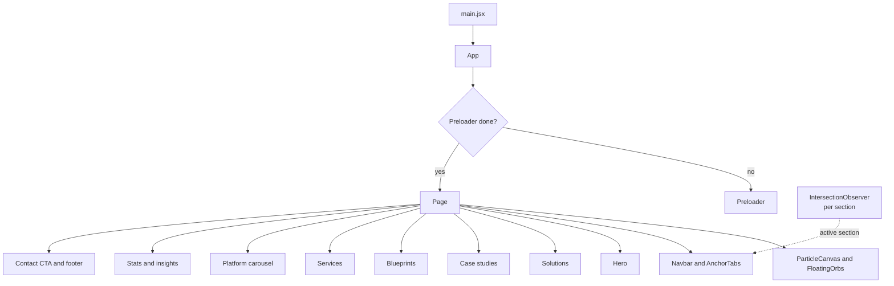
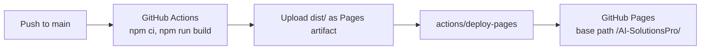

# Solution AI Pro landing page

A single-page marketing site for a concept service offering custom AI assistants to law firms and solo attorneys, built with React 19, Vite and Tailwind CSS and deployed to GitHub Pages.

<p>
  
  
  
  
  
</p>

## What it is

Small law practices are a poor fit for enterprise legal AI products on price and setup effort. This site is a front-end concept for a service that would build smaller, firm-specific assistants for research, contract review, document drafting and client intake.

It is a static landing page only. There is no backend, no AI model, no form handling and no data collection. The "Contact Us" buttons link to an anchor on the same page, and the footer social links are placeholders.

**About the content on the page:** the case studies, percentages, record counts, uptime figure, "15+ years" claim and product names (CaseMind, ContractGuard, SecureVault, IntakeFlow) are illustrative placeholder copy written for the design. They do not describe real clients, deployments or results.

## Features

- **Preloader** with an animated progress indicator before the page renders.
- **Particle background** drawn on a full-screen `<canvas>` with connecting lines between nearby particles.
- **3D effects with CSS only.** Cards tilt toward the cursor using perspective transforms (`use3DTilt`), and sections reveal on scroll with rotate and translate transitions. No WebGL.
- **Scroll-aware navigation.** An `IntersectionObserver` per section highlights the active item in the navbar and the sticky anchor tabs.
- **Auto-rotating product carousel** that advances every 5 seconds, with manual previous and next controls.
- **Count-up statistics** that animate when scrolled into view.
- **Responsive layout** using `clamp()` sizing and a collapsible mobile menu.
- **CI deploy.** Every push to `main` runs `npm ci` and `npm run build` in GitHub Actions and publishes `dist/` to GitHub Pages.

## Page structure





## Quickstart

Requires Node.js 20 or later (the deploy workflow uses Node 20).

```bash
git clone https://github.com/Jaswanthnani02/AI-SolutionsPro.git
cd AI-SolutionsPro
npm ci
npm run dev        # Vite dev server with hot reload
npm run build      # production build into dist/
npm run preview    # serve the built site locally
```

`npm ci` and `npm run build` were run successfully on Node 22; the build produces one HTML file, one CSS file of about 10 kB and one JavaScript bundle of about 229 kB (69 kB gzipped). `npm run lint` currently reports three `react-hooks` errors and three warnings in `src/App.jsx`.

The Vite `base` is set to `/AI-SolutionsPro/` to match the GitHub Pages project path. Change it in `vite.config.js` if you deploy elsewhere.

## Project structure

| Path | Purpose |
|---|---|
| `src/App.jsx` | The whole page: hooks for scroll, mouse, in-view and tilt effects, and every section component |
| `src/index.css` | Tailwind import, theme tokens (colors and fonts), keyframe animations |
| `src/main.jsx` | React entry point |
| `index.html` | HTML shell, page title and meta description |
| `public/` | Favicon and SVG icons |
| `vite.config.js` | React and Tailwind plugins, GitHub Pages base path |
| `eslint.config.js` | ESLint flat config with React Hooks and React Refresh rules |
| `.github/workflows/deploy.yml` | Build and deploy to GitHub Pages on push to `main` |

## Stack

React 19, Vite 8, Tailwind CSS 4 (via `@tailwindcss/vite`), ESLint 9, GitHub Actions and GitHub Pages. Fonts are loaded from Google Fonts (Orbitron, DM Sans, JetBrains Mono).

---

[Jaswanth Gaddam on GitHub](https://github.com/Jaswanthnani02)
